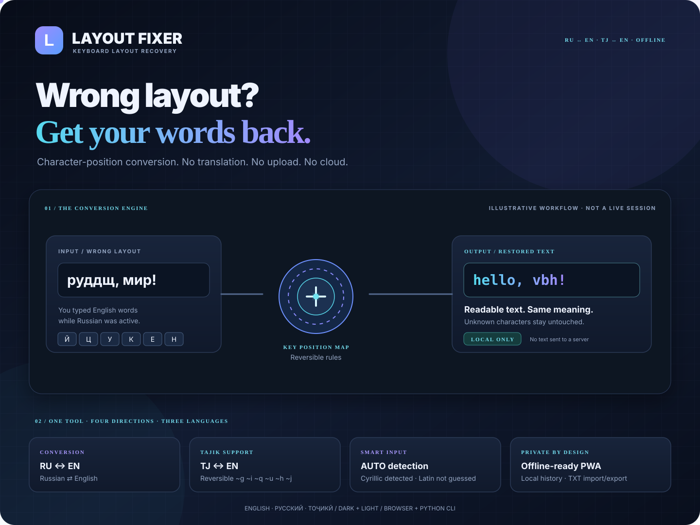

<div align="center">



# LAYOUT FIXER

### Wrong layout? Get your words back.

**Private, offline-ready keyboard-layout correction for Russian, English and Tajik.**

[](#version-history)
[](#offline-and-privacy)
[](#interface-languages)
[](https://www.python.org/)

[Try it locally](#run-the-web-app) · [Features](#features) · [Keyboard mapping](#keyboard-mapping) · [Tests](#tests)

</div>

---

## What it does

You meant to type `hello`, but your keyboard was set to Russian — and the screen shows `руддщ`.

Layout Fixer restores the intended text by mapping **physical keyboard positions**, not by translating words. Conversion happens locally in your browser or through the Python CLI. Your input is not sent to a remote API.

## At a glance

| Capability | Details |
|---|---|
| Four conversion directions | RU → EN, EN → RU, TJ → EN, EN → TJ |
| AUTO mode | Detects Russian or Tajik Cyrillic; never guesses the target for Latin input |
| Tajik-specific letters | Reversible escape codes for ғ, ӣ, қ, ӯ, ҳ and ҷ |
| Interface languages | English, Russian and Tajik |
| Editing | Paste, clear, swap, import TXT, copy and download |
| Local history | Up to 20 recent conversions in browser storage |
| Themes | Dark and light |
| PWA | Installable app shell with service-worker caching |
| Python CLI | Same four conversion directions from the terminal |

## How conversion works

1. **Read the characters** — inspect the text without uploading it.
2. **Choose a direction** — select one of four mappings or AUTO for Cyrillic input.
3. **Map key positions** — replace each recognized character with the character at the corresponding keyboard position.
4. **Preserve what is unknown** — characters outside the selected mapping remain unchanged.
5. **Review and reuse** — copy, download or swap the result.

AUTO is intentionally conservative: it can identify Russian/Tajik Cyrillic input, but Latin text is ambiguous. Choose EN → RU or EN → TJ explicitly.

## Features

- **Browser editor:** two-pane input and result workspace.
- **Four explicit mappings:** predictable source-to-target conversion.
- **Tajik support:** dedicated reversible codes for letters not represented by the standard Russian mapping.
- **AUTO detection:** Cyrillic source detection with no unsupported Latin guessing.
- **Three interface languages:** English, Русский, Тоҷикӣ.
- **Text utilities:** paste, clear, swap, import `.txt`, copy and download.
- **History:** up to 20 recent conversions, stored locally in the current browser.
- **Themes:** dark and light appearance.
- **Responsive layout:** adapts to mobile, tablet and desktop screens.
- **Installable PWA:** manifest and service worker for repeat visits and offline app-shell use.
- **Python CLI:** local terminal conversion without a browser.

## Keyboard mapping

Russian letters follow standard Windows keyboard key positions. Characters not included in the mapping are preserved.

### Tajik-specific reversible codes

| Tajik | Code | Tajik | Code |
|---|---|---|---|
| ғ | `~g` | Ғ | `~G` |
| ӣ | `~i` | Ӣ | `~I` |
| қ | `~q` | Қ | `~Q` |
| ӯ | `~u` | Ӯ | `~U` |
| ҳ | `~h` | Ҳ | `~H` |
| ҷ | `~j` | Ҷ | `~J` |

These escape sequences are Layout Fixer's reversible convention. They are not a claim that all physical Tajik keyboards use the same key positions.

## Run the web app

### Android — Termux

```bash
pkg update
pkg install git python
git clone https://github.com/Khayom1/layout-fixer.git
cd layout-fixer
python -m http.server 8000 --bind 127.0.0.1
```

Open **http://127.0.0.1:8000/** in the phone browser. Keep the Termux session running.

### Desktop

```bash
git clone https://github.com/Khayom1/layout-fixer.git
cd layout-fixer
python -m http.server 8000
```

Open **http://localhost:8000/**.

You can also open `index.html` directly in a modern browser. Service-worker installation and offline caching require a supported secure context such as HTTPS or localhost.

## Python command-line interface

Python 3.10 or newer is recommended.

```bash
python layout_fixer.py
```

Choose:

| Option | Direction |
|---|---|
| 1 | Russian → English |
| 2 | English → Russian |
| 3 | Tajik → English |
| 4 | English → Tajik |
| A | AUTO for Russian/Tajik Cyrillic |
| 0 | Exit |

AUTO does not infer a target layout for Latin or mixed-script input. Select a direction explicitly in those cases.

## Offline and privacy

- Browser conversion runs in the browser; CLI conversion runs locally in Python.
- The project does not upload entered text to a server or call a conversion API.
- Recent conversions are stored in the browser's local storage on that device.
- Imported TXT files are read locally; files larger than 2 MB are rejected.
- The service worker caches the app shell after a successful load, enabling repeat visits offline in supported browsers.
- The first visit still needs the files to be available locally or downloaded over a connection.

**Privacy boundary:** browser extensions, device backups and other software on the device are outside this project's control. Clear local history if you do not want it retained in that browser.

## Tests

```bash
python -m unittest discover -s tests -v
```

The test suite covers Russian and Tajik round trips, preservation of unmapped characters, invalid directions and AUTO detection behavior.

Manual browser testing is also recommended for clipboard permissions, file import, PWA installation and offline cache behavior.

## Project structure

```text
layout-fixer/
├── index.html                       # Responsive browser application
├── app.js                           # Browser conversion engine and UI
├── layout_fixer.py                  # Python CLI conversion engine
├── manifest.webmanifest             # PWA metadata
├── sw.js                            # Offline app-shell cache
├── tests/
│   └── test_layout_fixer.py         # Python unit tests
└── assets/
    ├── icon.svg                     # Application icon
    ├── layout-fixer-hero.svg        # Compact animated hero
    ├── layout-fixer-showcase.svg    # Full product showcase
    └── layout-fixer-preview.png     # Application screenshot
```

## Interface languages

The interface is available in **English**, **Russian** and **Tajik**. Choose the language selector in the top-right corner of the app.

## Version history

### 4.2 — 10 November 2026

- Rebuilt browser conversion logic as a separate `app.js` module.
- Corrected Tajik reverse conversion with reversible escape codes.
- Made AUTO detection conservative for Latin and mixed-script input.
- Fixed direction labels, swap behavior, local history and file-size validation.
- Rebuilt the Python CLI and added automated unit tests.
- Added animated SVG repository artwork and expanded project documentation.

### 4.0 — 9 November 2026

- Added AUTO mode, three interface languages and browser history.
- Added import, download, copy, paste, swap and theme controls.

### 3.0 — 9 November 2026

- Added Tajik keyboard mapping and multilingual interface.

## Roadmap

- Browser-based automated tests.
- Configurable keyboard profiles.
- Improved mixed-script detection without guessing the target layout.

Roadmap items are planned improvements, not features currently claimed as implemented.

## License

No license file is currently included. The repository is therefore not yet explicitly licensed for reuse or redistribution. Add a license file after choosing the terms you want to publish under.

<div align="center">

**Built by [Khayom Abdurahmonov](https://github.com/Khayom1)**

[Repository](https://github.com/Khayom1/layout-fixer) · [Issues](https://github.com/Khayom1/layout-fixer/issues)

*Fix the layout. Keep your words.*

</div>

---

## Тоҷикӣ

**Layout Fixer** матнеро барқарор мекунад, ки ҳангоми фаъол будани раскладкаи нодуруст чоп шудааст. Ин тарҷумон нест: ҳарфҳо аз рӯи ҷойи тугмаҳои клавиатура иваз мешаванд. Коркард дар браузер ё Python-и худи дастгоҳ анҷом меёбад.

- Чор самт: RU → EN, EN → RU, TJ → EN, EN → TJ.
- AUTO матни кириллиро муайян мекунад, аммо барои матни лотинӣ самтро тахмин намекунад.
- Шаш ҳарфи махсуси тоҷикӣ бо рамзҳои баргардондашавандаи `~g ~i ~q ~u ~h ~j` дастгирӣ мешаванд.
- Интерфейс бо тоҷикӣ, русӣ ва англисӣ.
- Нусхабардорӣ, гузоштан, иваз кардани самт, воридоти TXT, боргирӣ ва таърихи маҳаллӣ.
- Пас аз бор шудани файлҳо дар браузерҳои мувофиқ бе интернет кор мекунад.

### Насб дар Termux

```bash
pkg update
pkg install git python
git clone https://github.com/Khayom1/layout-fixer.git
cd layout-fixer
python -m http.server 8000 --bind 127.0.0.1
```

Дар браузер **http://127.0.0.1:8000/**-ро кушоед.

### Санҷишҳо

```bash
python -m unittest discover -s tests -v
```

---

## Русский

**Layout Fixer** восстанавливает текст, набранный при неверно выбранной раскладке. Это не переводчик: символы заменяются по позициям клавиш. Обработка выполняется локально в браузере или Python CLI.

- Четыре направления: RU → EN, EN → RU, TJ → EN, EN → TJ.
- AUTO распознаёт русскую и таджикскую кириллицу, но не угадывает целевую раскладку для латиницы.
- Шесть специальных таджикских букв используют обратимые коды `~g ~i ~q ~u ~h ~j`.
- Интерфейс на английском, русском и таджикском.
- Импорт TXT, копирование, вставка, обмен направления, скачивание и локальная история.
- Офлайн-режим после загрузки приложения в поддерживаемом браузере.

### Установка в Termux

```bash
pkg update
pkg install git python
git clone https://github.com/Khayom1/layout-fixer.git
cd layout-fixer
python -m http.server 8000 --bind 127.0.0.1
```

Откройте **http://127.0.0.1:8000/**.

### Тесты

```bash
python -m unittest discover -s tests -v
```
