  

<h1 align="center">LAYOUT FIXER 4.1</h1>

<strong>From mistyped characters to readable text — locally, privately, instantly.</strong>

  
  
  

**Author:** Khayom Abdurahmonov  
**Release:** 4.1 · **Updated:** 10 November 2026  
**Type:** Lightweight, browser-based keyboard-layout correction tool

Layout Fixer repairs text typed while the wrong keyboard layout was active. It is **not a translator**: it maps characters by keyboard positions. The web application runs locally in your browser and does not send text to a server.

## Preview

  

## Features

- **Four explicit directions:** RU → EN, EN → RU, TJ → EN and EN → TJ.
- **AUTO detection for Cyrillic:** identifies Russian or Tajik Cyrillic input.
- **Honest Latin handling:** AUTO does not guess whether Latin text should become Russian or Tajik; choose the target direction.
- **Three interface languages:** English, Русский and Тоҷикӣ.
- **Editing tools:** paste, clear, swap direction, import TXT, copy and download results.
- **Local history:** up to 20 recent conversions stored in browser storage.
- **Dark and light themes.**
- **Responsive interface:** designed for phones, tablets and desktop browsers.
- **Offline operation:** after the project files have loaded, conversion needs no network connection.

## Keyboard mapping

### Russian

Russian characters use standard Windows keyboard key positions. Characters outside the mapping are preserved. Punctuation keys that share a physical position with letters follow the same key-position mapping.

### Tajik

The Tajik alphabet includes letters that are not present in the standard Russian layout. To avoid collisions and make conversion reversible, the six additional Tajik letters use explicit tilde escape codes:

| Tajik | Code | Tajik | Code |
|---|---|---|---|
| ғ | **~g** | Ғ | **~G** |
| ӣ | **~i** | Ӣ | **~I** |
| қ | **~q** | Қ | **~Q** |
| ӯ | **~u** | Ӯ | **~U** |
| ҳ | **~h** | Ҳ | **~H** |
| ҷ | **~j** | Ҷ | **~J** |

These are **Layout Fixer reversible codes**, not a claim that every physical Tajik keyboard uses these exact key positions. The tilde convention prevents collisions in the mapping.

## Run the web app

### Option A — open locally

1. Download or clone this repository.
2. Keep **index.html** and **app.js** in the same directory.
3. Open **index.html** in a modern browser.

### Option B — Android with Termux

~~~bash
pkg update
pkg install git python
git clone https://github.com/Khayom1/layout-fixer.git
cd layout-fixer
python -m http.server 8000 --bind 127.0.0.1
~~~

Open **http://127.0.0.1:8000/** in your phone browser. Keep the Termux session running while using the local server.

### Option C — desktop

~~~bash
python -m http.server 8000
~~~

Then visit **http://localhost:8000/**.

## Run the Python CLI

The Python command-line engine supports the same four directions:

~~~bash
python layout_fixer.py
~~~

Choose **1** for RU → EN, **2** for EN → RU, **3** for TJ → EN, **4** for EN → TJ, or **A** for Cyrillic AUTO detection.

## Run tests

Python 3.9 or newer is recommended.

~~~bash
python -m unittest discover -s tests -v
~~~

The test suite checks Russian round trips, Tajik round trips, preservation of unmapped characters, invalid directions and AUTO detection behavior.

## Project structure

~~~text
layout-fixer/
├── index.html                  # Responsive application shell and styles
├── app.js                      # Browser conversion engine and interface logic
├── layout_fixer.py             # Python command-line engine
├── tests/
│   └── test_layout_fixer.py    # Python unit tests
└── assets/
    ├── layout-fixer-hero.svg   # Animated SVG repository banner
    ├── layout-fixer-banner.gif # Previous visual banner
    └── layout-fixer-preview.png
~~~

## Privacy

- Conversion is performed in the browser or locally by the Python script.
- Text is not uploaded to an API by this project.
- Browser history is stored in local storage on the device.
- Imported text files are read locally; files larger than 2 MB are rejected by the web app.

## Version history

### 4.1 — 10 November 2026
- Rebuilt the browser conversion logic as a separate **app.js** module.
- Corrected Tajik reverse conversion using unambiguous, reversible escape codes.
- Corrected AUTO behavior: detects Cyrillic source scripts and no longer guesses the target for Latin input.
- Fixed direction labels, swap behavior, local history handling and file-size validation.
- Rebuilt the Python CLI for all four directions.
- Added automated Python unit tests.
- Added an animated SVG hero banner and rewrote this README.

### 4.0 — 9 November 2026
- Added AUTO mode, three interface languages and browser history.
- Added import, download, copy, paste, swap and theme controls.

### 3.0 — 9 November 2026
- Added Tajik keyboard mapping and multilingual interface.

## Roadmap

- Browser-based automated tests.
- More configurable keyboard profiles.
- Improved mixed-script detection without guessing conversion targets.

## License

No license file is currently included. Add a LICENSE file with the full MIT license text before distributing the project under the MIT license.

---

## Тоҷикӣ

**Layout Fixer** матнеро ислоҳ мекунад, ки бо раскладкаи нодурусти клавиатура чоп шудааст. Ин тарҷумон нест: ҳарфҳоро мувофиқи ҷойи тугмаҳо табдил медиҳад. Коркард дар худи браузер ё компютер анҷом мешавад.

### Имкониятҳо
- Чор самт: RU → EN, EN → RU, TJ → EN ва EN → TJ.
- Муайянкунии худкори матни кириллии русӣ ва тоҷикӣ.
- Барои матни лотинӣ реҷаи AUTO самти мақсадро тахмин намекунад; самтро дастӣ интихоб кунед.
- Интерфейс бо тоҷикӣ, русӣ ва англисӣ.
- Гузоштан, пок кардан, иваз кардани самт, воридоти TXT, нусхабардорӣ ва боргирӣ.
- Таърихи маҳаллӣ, реҷаи равшан ва торик.
- Пас аз бор шудани файлҳо бе интернет кор мекунад.

### Рамзҳои ҳарфҳои махсуси тоҷикӣ

Барои он ки табдил баргардондашаванда бошад ва ҳарфҳо ба якдигар бархӯрд накунанд, шаш ҳарфи махсус чунин рамз доранд: **ғ = ~g**, **ӣ = ~i**, **қ = ~q**, **ӯ = ~u**, **ҳ = ~h**, **ҷ = ~j**. Ҳарфҳои калон бо **~G**, **~I**, **~Q**, **~U**, **~H**, **~J** ифода мешаванд. Ин рамзҳои дохилии Layout Fixer мебошанд, на стандарти умумии клавиатура.

### Насб дар Android (Termux)

~~~bash
pkg update
pkg install git python
git clone https://github.com/Khayom1/layout-fixer.git
cd layout-fixer
python -m http.server 8000 --bind 127.0.0.1
~~~

Дар браузер **http://127.0.0.1:8000/**-ро кушоед.

### Санҷишҳо

~~~bash
python -m unittest discover -s tests -v
~~~

---

## Русский

**Layout Fixer** восстанавливает текст, набранный при неверно выбранной раскладке клавиатуры. Это не переводчик: символы заменяются по позициям клавиш. Обработка выполняется локально в браузере или Python CLI.

### Возможности
- Четыре направления: RU → EN, EN → RU, TJ → EN и EN → TJ.
- AUTO распознаёт русскую и таджикскую кириллицу.
- Для латинского текста AUTO не угадывает целевую раскладку — выберите EN → RU или EN → TJ.
- Интерфейс на английском, русском и таджикском.
- Вставка, очистка, обмен направления, импорт TXT, копирование и скачивание.
- Локальная история, светлая и тёмная темы.
- Работа без сети после загрузки файлов.

### Установка

~~~bash
pkg update
pkg install git python
git clone https://github.com/Khayom1/layout-fixer.git
cd layout-fixer
python -m http.server 8000 --bind 127.0.0.1
~~~

Откройте **http://127.0.0.1:8000/** в браузере.

### Тесты

~~~bash
python -m unittest discover -s tests -v
~~~

